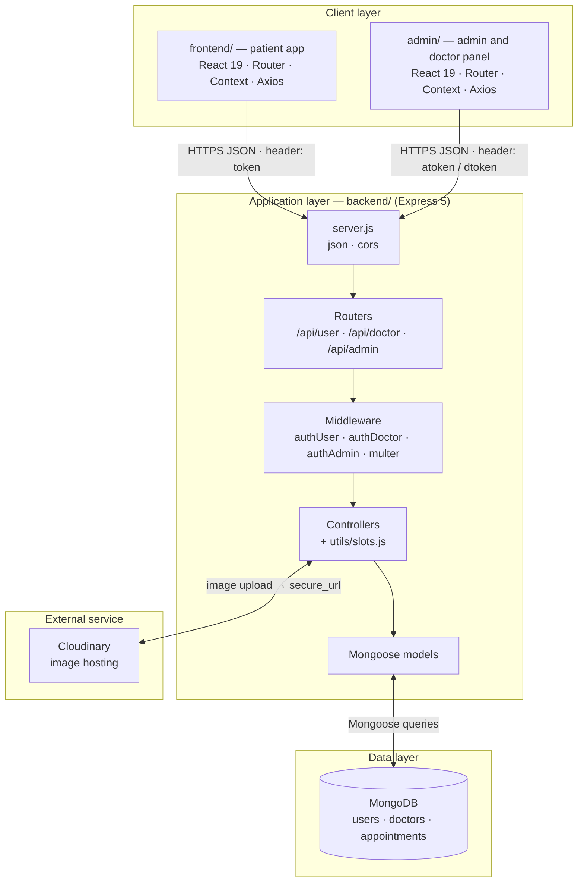
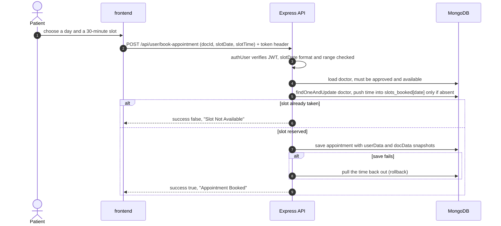
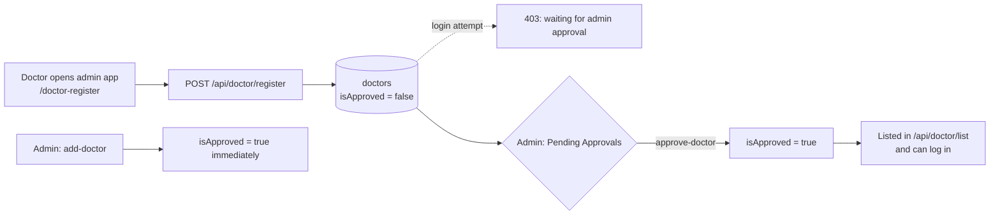
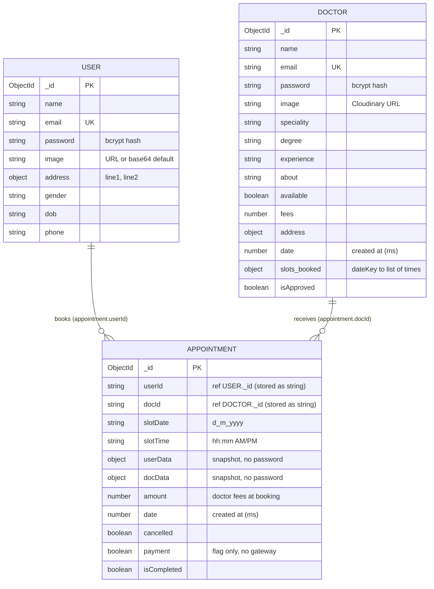

<div align="center">


<br />

**A MERN-stack platform where patients book doctors online, doctors manage their own schedule, and admins approve and oversee everything — built as three separate apps on one REST API.**

<br />

</div>

---

## Table of Contents

- [Project Overview](#project-overview)
- [Key Features](#key-features)
- [Application Preview](#application-preview)
- [System Architecture](#system-architecture)
- [Core Workflows](#core-workflows)
- [Technology Stack](#technology-stack)
- [Project Structure](#project-structure)
- [Database Design](#database-design)
- [API Reference](#api-reference)
- [Authentication and Security](#authentication-and-security)
- [Installation and Local Setup](#installation-and-local-setup)
- [Environment Variables](#environment-variables)
- [Future Improvements](#future-improvements)

---

## Project Overview

**The problem.** Booking a doctor usually means phone calls, back-and-forth about free times, and no single place where clinics can see who is booked when. Double bookings happen when two people pick the same time.

**The solution.** Docsyra gives each group of users the tool they need:

| User | Uses | What they do |
|---|---|---|
| **Patient** | `frontend/` | Browse doctors by speciality, pick a free 30-minute slot, book, and cancel |
| **Doctor** | `admin/` (doctor login) | Review their own appointments, mark them completed or cancelled, update fees/address/about, toggle availability |
| **Admin** | `admin/` (admin login) | Add doctors, approve self-registered doctors, see every appointment and platform totals |

The three applications are deployed and developed independently and talk to one Express API, which is the only component that touches MongoDB and Cloudinary.

---

## Key Features

**For patients**
- Sign up and log in with email and password (JWT, 7-day expiry)
- Browse approved doctors and filter by speciality (General physician, Gynecologist, Dermatologist, Pediatricians, Neurologist, Gastroenterologist)
- 7-day slot picker with 30-minute slots between 10:00 and 21:00; slots already booked are hidden
- Book and cancel appointments; view all appointments with status
- Edit profile (name, phone, address, date of birth, gender) and upload a profile photo

**For doctors**
- Self-registration with photo; the account stays inactive until an admin approves it
- Dashboard with earnings, appointment count and patient count
- Complete or cancel their own appointments (cancelling frees the slot)
- Update fees, address and "about"; toggle their own availability

**For administrators**
- Dashboard with doctor, patient and appointment totals plus the latest bookings
- Add doctors directly (auto-approved), list them, toggle availability, remove them
- Pending Approvals queue for self-registered doctors
- View and cancel any appointment

**Booking integrity**
- Slot reservation is a single atomic MongoDB update, backed by a unique partial index on active bookings, so two patients cannot both get the same slot
- Appointments store snapshots of the patient and doctor data at booking time


---

## Application Preview


| App | Route | Screen |
|---|---|---|
| Patient (`:5173`) | `/` | Home: hero, speciality menu, top doctors |
| Patient | `/doctors`, `/doctors/:speciality` | Doctor directory with speciality filter |
| Patient | `/appointment/:docId` | Doctor profile and 7-day slot picker |
| Patient | `/my-appointment` | My appointments (cancel) |
| Patient | `/my-profile` | Profile and photo upload |
| Patient | `/login`, `/register` | Sign in / sign up |
| Admin (`:5174`) | `/` | Admin / Doctor login |
| Admin | `/admin-dashboard`, `/all-appointments`, `/add-doctor`, `/doctor-list`, `/pending-approvals` | Admin screens |
| Admin | `/doctor-dashboard`, `/doctor-appointments`, `/doctor-profile` | Doctor screens |
| Admin | `/doctor-register` | Doctor self-registration |

---

## System Architecture


The request pipeline inside the API is the same for every endpoint: **router → middleware → controller → Mongoose model**.

| Layer | Components | Responsibility |
|---|---|---|
| **Client** | `frontend/` (patient), `admin/` (admin + doctor) | UI, routing, token storage in `localStorage`, Axios calls to the API |
| **Application** | Express 5 in `backend/` | Routing, JWT verification, image upload handling, validation, business rules |
| **Data** | MongoDB, database `docsyra` | `users`, `doctors`, `appointments` collections via Mongoose |
| **External** | Cloudinary | Stores profile and doctor photos; the database keeps only the returned `secure_url` |




</details>

---

## Core Workflows

### 1. Registration and login

1. **Patient:** `POST /api/user/register` validates the email format and an 8-character minimum password, hashes the password with bcrypt, saves the user and returns a JWT (7 days). Login compares the password with bcrypt and returns the same kind of token. The frontend stores it in `localStorage` as `token` and sends it in the `token` header.
2. **Doctor:** `POST /api/doctor/login` also checks `isApproved`; unapproved doctors get HTTP 403. The admin app stores the token as `dToken`.
3. **Admin:** `POST /api/admin/login` compares the submitted credentials with `ADMIN_EMAIL` / `ADMIN_PASSWORD` from the server environment and returns a 1-day JWT carrying `role: "admin"`. The admin app stores it as `aToken`.

### 2. Doctor discovery

The patient app calls the public `GET /api/doctor/list` once, keeps the result in React Context, and filters by speciality in the browser. The endpoint returns only approved doctors and omits `password` and `email`.

### 3. Appointment booking and slot validation



How conflicts are prevented:

- **Atomic reservation.** The controller runs one `findOneAndUpdate` whose filter requires the time **not** to be in `slots_booked.<date>` (`$nin`), then `$push`es it. Two simultaneous requests for the same slot cannot both match.
- **Second guard.** `appointments` has a unique partial index on `(docId, slotDate, slotTime)` for documents where `cancelled` is `false`. A duplicate-key error is reported as "Slot Not Available".
- **Rollback.** If saving the appointment fails after the reservation, the time is `$pull`ed back out so the slot is not blocked forever.
- **Input checks.** `slotDate` must match `d_m_yyyy`, be a real calendar date, and fall between about yesterday and 30 days ahead. `slotTime` is normalised (non-breaking spaces, case) before comparison.

### 4. Doctor onboarding and approval



### 5. Cancellation and completion

- Patients, the doctor concerned, and admins can cancel. All three call the same helper, `cancelAndReleaseSlot`, which sets `cancelled: true` with a conditional update (only if not already cancelled or completed) and then `$pull`s the time from the doctor's `slots_booked`. Patients can only cancel their own appointments and doctors only their own.
- Only the doctor can mark an appointment completed, and only if it is not cancelled or already completed.

### 6. Image upload

`multer` accepts a single `image` file (image MIME types only, 5 MB limit) into a temporary file with a random name. The controller uploads it to Cloudinary with the Node SDK, stores the returned `secure_url` on the user or doctor, and deletes the temporary file in a `finally` block. Used by: patient profile update, admin add-doctor (image required), and doctor self-registration (image optional).

---

## Technology Stack

| Technology | Why it is used in Docsyra |
|---|---|
| **React 19 + Vite 8** | Two separate SPAs (patient app and admin/doctor panel) with fast dev servers on ports 5173 and 5174 |
| **React Router 7** | Route-level pages; the admin app renders a different route tree for admin, doctor, or logged-out users |
| **Context API** | Small global state: token, doctors list and profile in the patient app; separate `AdminContext` and `DoctorContext` in the panel |
| **Axios** | API calls with per-role auth headers |
| **Tailwind CSS 4** | Utility-first styling through `@tailwindcss/vite` |
| **React Toastify** | User feedback for API results and errors |
| **Node.js + Express 5** | REST API with ES modules and router-per-role organisation |
| **MongoDB + Mongoose 9** | Flexible documents: embedded snapshots, the `slots_booked` map, and a partial unique index |
| **jsonwebtoken** | Stateless authentication for patients, doctors and the admin |
| **bcrypt** | Password hashing for users and doctors |
| **validator** | Email format validation |
| **multer** | Multipart parsing with file type and size limits |
| **Cloudinary** | Hosted image storage so uploads do not live on the API server's disk |
| **Vercel config** | `vercel.json` SPA rewrites in both frontends |

---

## Project Structure

```text
Docsyra/
├── backend/                     Express REST API
│   ├── server.js                App entry: middleware, routers, error handler
│   ├── config/
│   │   ├── mongodb.js           Mongoose connection (database "docsyra")
│   │   └── cloudinary.js        Cloudinary SDK configuration
│   ├── routes/                  userRoute.js · doctorRoute.js · adminRoute.js
│   ├── middlewares/             authUser.js · authDoctor.js · authAdmin.js · multer.js
│   ├── controllers/             userController.js · doctorController.js · adminController.js
│   ├── models/                  userModel.js · doctorModel.js · appointmentModel.js
│   ├── utils/slots.js           Slot-date validation, atomic cancel + slot release, temp-file cleanup
│   └── approveAllDoctors.js     One-off maintenance script: approves every pending doctor
│
├── frontend/                    Patient web app (Vite, port 5173)
│   └── src/
│       ├── pages/               Home, Doctor, Appointment, Myappointments, MyProfile, Login, About, Contact
│       ├── components/          Navbar, Header, SpecialityMenu, TopDoctors, RelatedDoctors, Banner, Footer
│       ├── context/AppContext.jsx   Token, doctors, profile, backend URL
│       └── assets/              Images, icons, sample data
│
├── admin/                       Admin + doctor panel (Vite, port 5174)
│   └── src/
│       ├── pages/Admin/         Dashboard, AllAppointments, AddDoctor, DoctorsList, PendingApprovals
│       ├── pages/Doctor/        DoctorDashboard, DoctorAppointments, DoctorProfile
│       ├── pages/               Login, DoctorRegister
│       ├── components/          Navbar, Sidebar
│       └── context/             AdminContext, DoctorContext, AppContext (helpers)
│
├── docs/                        README assets (diagrams, schema source, screenshot guide)
├── CHANGES.md                   Log of a bug-fix pass over backend, frontend and admin
└── LICENSE                      MIT
```

---

## Database Design

MongoDB database name: `docsyra` (appended to `MONGODB_URI` in `backend/config/mongodb.js`). Mongoose creates the collections `users`, `doctors` and `appointments`.




Notes on the model:

- `appointments.userId` and `docId` are stored as **strings**, not `ObjectId` references; there is no `populate()`. Instead, each appointment embeds `userData` and `docData` snapshots, so history stays accurate if a profile changes later.
- `doctors.slots_booked` is an object keyed by `d_m_yyyy`, e.g. `{ "23_10_2026": ["10:00 AM", "10:30 AM"] }`. It is the fast availability lookup used by the UI and by the atomic reservation.
- `users.email` and `doctors.email` are unique. Patient registration and doctor self-registration lower-case and trim the email; admin "Add Doctor" stores it as typed, and doctor login tries both the normalised and the raw value.
- Indexes: unique email indexes plus a unique **partial** index on `appointments (docId, slotDate, slotTime)` where `cancelled` is `false`, so cancelled bookings never block a slot.

---

## API Reference

Base URL (local): `http://localhost:4000`. All API routes return JSON. Most responses use the shape `{ "success": true|false, "message": "…" }` plus data fields.

**Auth headers**

| Role | Header(s) | Token payload |
|---|---|---|
| Patient | `token: <jwt>` | `{ id }` |
| Doctor | `dtoken: <jwt>` or `Authorization: Bearer <jwt>` | `{ id }` |
| Admin | `atoken: <jwt>` | `{ role: "admin" }` |


<details>
<summary><b>Patient endpoints — <code>/api/user</code></b></summary>

| Method | Path | Auth | Purpose | Request fields | Success response |
|---|---|---|---|---|---|
| POST | `/register` | none | Create patient account | `name`, `email`, `password` (≥ 8 chars) | `{ success, token }` |
| POST | `/login` | none | Log in | `email`, `password` | `{ success, token }` |
| GET | `/get-profile` | patient | Current profile (no password) | – | `{ success, userData }` |
| POST | `/update-profile` | patient | Update profile and optional photo | multipart: `name`, `phone`, `dob`, `gender`, `address` (JSON string), optional `image` | `{ success, message: "Profile Updated" }` |
| POST | `/book-appointment` | patient | Book a slot | `docId`, `slotDate` (`d_m_yyyy`), `slotTime` | `{ success, message: "Appointment Booked" }` |
| GET | `/appointments` | patient | Own appointments | – | `{ success, appointments }` |
| POST | `/cancel-appointment` | patient | Cancel own appointment and release slot | `appointmentId` | `{ success, message: "Appointment Cancelled" }` |

Common errors: `Missing Details`, `Please enter a valid email`, `Please enter a strong password`, `User already exists with this email`, `Invalid credentials`, `Invalid slot date`, `Doctor Not Found`, `Doctor Not Available`, `Slot Not Available`, `Appointment not found, already cancelled or completed`.

</details>

<details>
<summary><b>Doctor endpoints — <code>/api/doctor</code></b></summary>

| Method | Path | Auth | Purpose | Request fields | Success response |
|---|---|---|---|---|---|
| GET | `/list` | none | Approved doctors (no `password`, no `email`) | – | `{ success, doctors }` |
| POST | `/register` | none | Self-register (created unapproved) | multipart: `name`, `email`, `password` (≥ 8), `speciality`, `degree`, `experience`, `about`, `fees`, `address` (JSON string), optional `image` | `{ success, message }` |
| POST | `/login` | none | Log in (approved doctors only) | `email`, `password` | `{ success, token }` |
| GET | `/appointments` | doctor | Own appointments | – | `{ success, appointments }` |
| POST | `/cancel-appointment` | doctor | Cancel own appointment, release slot | `appointmentId` | `{ success, message }` |
| POST | `/complete-appointment` | doctor | Mark own appointment completed | `appointmentId` | `{ success, message }` |
| POST | `/change-availability` | doctor | Toggle own availability | – | `{ success, message }` |
| GET | `/dashboard` | doctor | Earnings, counts, latest 5 | – | `{ success, dashData: { earnings, appointments, patients, latestAppointments } }` |
| GET | `/profile` | doctor | Own profile (no password) | – | `{ success, profileData }` |
| POST | `/update-profile` | doctor | Update `fees`, `address`, `about`, `available` (only sent fields are written) | any of those fields | `{ success, message: "Profile Updated" }` |


</details>

<details>
<summary><b>Admin endpoints — <code>/api/admin</code></b></summary>

| Method | Path | Auth | Purpose | Request fields | Success response |
|---|---|---|---|---|---|
| POST | `/login` | none | Admin login against `ADMIN_EMAIL` / `ADMIN_PASSWORD` | `email`, `password` | `{ success, token }` |
| POST | `/add-doctor` | admin | Add an approved doctor | multipart: `name`, `email`, `password` (≥ 8), `speciality`, `degree`, `experience`, `about`, `fees`, `address` (JSON string), **`image` (required)** | `{ success, message: "Doctor Added" }` |
| GET | `/all-doctors` | admin | All doctors (no password) | – | `{ success, doctors }` |
| POST | `/change-availability` | admin | Toggle a doctor's availability | `docId` | `{ success, message }` |
| GET | `/appointments` | admin | All appointments | – | `{ success, appointments }` |
| POST | `/cancel-appointment` | admin | Cancel any appointment, release slot | `appointmentId` | `{ success, message }` |
| GET | `/dashboard` | admin | Totals and latest 5 appointments | – | `{ success, dashData: { doctors, appointments, patients, latestAppointments } }` |
| POST | `/remove-doctor` | admin | Delete a doctor and cancel their open appointments | `docId` | `{ success, message }` |
| GET | `/pending-doctors` | admin | Doctors awaiting approval | – | `{ success, doctors }` |
| POST | `/approve-doctor` | admin | Approve a doctor | `docId` | `{ success, message: "Doctor Approved Successfully" }` |


</details>

---

## Authentication and Security

**Implemented**

- **Password hashing:** bcrypt with 10 salt rounds for patients and doctors; passwords are excluded from profile and list responses.
- **JWT:** signed with `JWT_SECRET`; patients and doctors get 7-day tokens, the admin a 1-day token. The admin token holds only `{ role: "admin" }`, not the password.
- **Per-role middleware:** `authUser`, `authDoctor` and `authAdmin` guard the route groups. `authAdmin` additionally requires `role === "admin"`.
- **Ownership checks:** patients can cancel only their own appointments, doctors can cancel/complete/toggle only their own, via conditional queries on `userId` / `docId`.
- **Approval gate:** unapproved doctors cannot log in and are not listed or bookable.
- **Login responses** use a generic "Invalid credentials" message so a response does not reveal whether an email exists.
- **Input validation:** required fields, `validator.isEmail`, minimum password length (8), numeric non-negative fees, JSON-parsed address, slot date format/range, and upload restrictions (image MIME type, 5 MB).
- **Uploads:** random file names, temporary files removed after the Cloudinary upload.
- **CORS:** can be restricted with `CORS_ORIGINS`.

**Limitations**

- Not a hardened system: there is **no rate limiting**, no security headers middleware, no account lockout, and no automated tests.
- JWTs live in `localStorage`, which is exposed to any XSS on the page; there are no refresh tokens or token revocation.
- Patient and doctor tokens carry only `id` and share one signing secret, so role separation relies on how controllers use the id rather than on a role claim.
---

## Installation and Local Setup

### Prerequisites

- **Node.js** and npm
- **MongoDB** — a local instance or a MongoDB Atlas cluster
- **Cloudinary account** — required for any image upload (admin add-doctor requires an image)
- **Git**

### 1. Clone

```bash
git clone https://github.com/<your-username>/Docsyra.git
cd Docsyra
```

### 2. Backend (port 4000)

<table>
<tr><th>Windows (PowerShell)</th><th>macOS / Linux</th></tr>
<tr><td>

```powershell
cd backend
npm install
copy .env.example .env
notepad .env
npm run server
```

</td><td>

```bash
cd backend
npm install
cp .env.example .env
nano .env
npm run server
```

</td></tr>
</table>

`npm run server` runs `nodemon server.js`; `npm start` runs `node server.js`. You should see `Server Started 4000` and `Database Connected`.

### 3. Patient app (port 5173)

```bash
cd frontend
npm install
cp .env.example .env      # Windows: copy .env.example .env
npm run dev
```

### 4. Admin and doctor panel (port 5174)

```bash
cd admin
npm install
cp .env.example .env      # Windows: copy .env.example .env
npm run dev
```

Open `http://localhost:5173` (patients) and `http://localhost:5174` (admin / doctors). Start the backend first.

### 5. First run

1. Log in to the admin panel with the `ADMIN_EMAIL` / `ADMIN_PASSWORD` you set in `backend/.env` (leave the toggle on **Admin**).
2. Add a doctor in **Add Doctor** (an image is required), or open `/doctor-register` and approve the new doctor under **Pending Approvals**.
3. Register as a patient in the patient app and book a slot.

### Setting up MongoDB

- **Atlas:** create a free cluster, create a database user, allow your IP under Network Access, and copy the connection string.
- **Important:** `MONGODB_URI` must have **no database name, trailing path or query string**, because the code builds the final URL as `` `${MONGODB_URI}/docsyra` ``.

### Setting up Cloudinary

Create a free account, then copy **Cloud name**, **API key** and **API secret** from the dashboard into `backend/.env`.

### Scripts

| App | Script | Command run |
|---|---|---|
| `backend` | `npm start` | `node server.js` |
| `backend` | `npm run server` | `nodemon server.js` |
| `frontend`, `admin` | `npm run dev` | `vite` |
| `frontend`, `admin` | `npm run build` | `vite build` |
| `frontend`, `admin` | `npm run lint` | `eslint .` |
| `frontend`, `admin` | `npm run preview` | `vite preview` |

`backend` has no test script (`npm test` is the default placeholder that exits with an error).

---

## Environment Variables


**`backend/.env`**

| Variable | Required | Purpose |
|---|---|---|
| `MONGODB_URI` | Yes | MongoDB connection string without database name (see above) |
| `JWT_SECRET` | Yes | Secret used to sign and verify all JWTs |
| `CLOUDINARY_CLOUD_NAME` | Yes* | Cloudinary cloud name |
| `CLOUDINARY_API_KEY` | Yes* | Cloudinary API key |
| `CLOUDINARY_API_SECRET` | Yes* | Cloudinary API secret |
| `ADMIN_EMAIL` | Yes | Admin login email |
| `ADMIN_PASSWORD` | Yes | Admin login password |
| `PORT` | No | API port (default `4000`) |


\* Required for any feature that uploads an image; the API itself starts without them.

**`frontend/.env`**

| Variable | Required | Purpose |
|---|---|---|
| `VITE_BACKEND_URL` | No | API base URL (default `http://localhost:4000`) |
| `VITE_ADMIN_URL` | No | Target of the navbar's admin-panel button (default `http://localhost:5174`) |

**`admin/.env`**

| Variable | Required | Purpose |
|---|---|---|
| `VITE_BACKEND_URL` | Recommended | API base URL. Most pages fall back to `http://localhost:4000`, but `src/context/AppContext.jsx` reads it without a fallback, so set it |
| `VITE_CURRENCY` | Recommended | Currency symbol displayed next to fees and amounts (e.g. `₹`) |

---


## Future Improvements

These are **not implemented**; they are the realistic next steps.

- Payment integration (the `payment` flag and "Pay Online" button are placeholders)
- Role claim in JWTs (or separate signing secrets) and httpOnly-cookie sessions with refresh tokens
- Rate limiting, `helmet`, and schema-based validation (for example Zod or Joi)
- Consistent HTTP status codes across all endpoints
- Automated tests (API integration tests for booking concurrency, component tests) and a CI workflow
- Email or SMS confirmations and reminders
- Store `userId` / `docId` as `ObjectId` references, add pagination to list endpoints
- Dockerfile / docker-compose for one-command local setup; OpenAPI documentation

---


<div align="center">
<br />
<sub>Docsyra · React · Express · MongoDB</sub>
</div>
